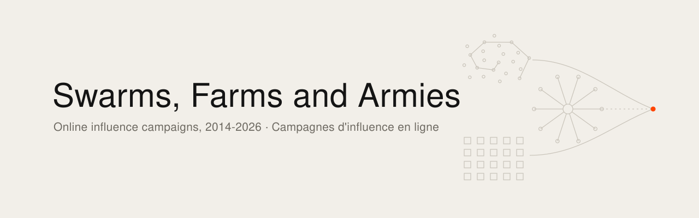
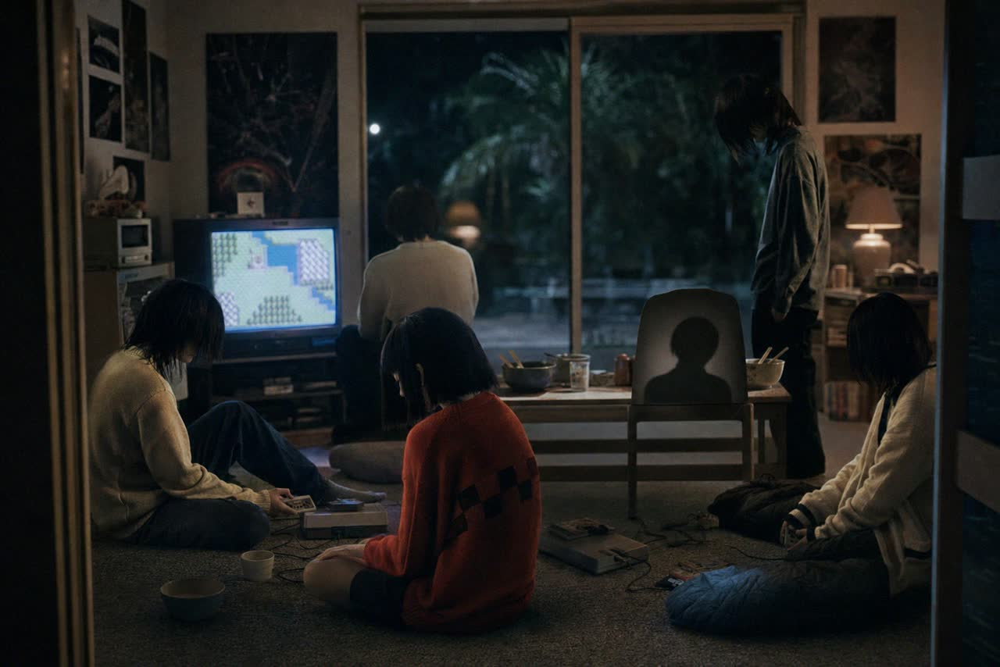

<picture><source media="(prefers-color-scheme: dark)" srcset="banner.svg"></picture>

[English](README.md) · [Français](README.fr.md)

# Essaims, fermes et armées

En octobre 2026, la réélection de Lula au Brésil, attribuée en partie au canal WhatsApp « Exército do Lula » du député André Janones, puis l'ouverture en France, quelques jours plus tard, de canaux militants du même modèle, ont relancé une question : est-ce que tout ça, c'est Gamergate qui recommence ? Ce rapport y répond en retraçant les campagnes d'influence en ligne de 2014 à 2026, avec des repères dès 2010, et en les rangeant en trois lignées qui convergent en 2026.

1. **L'essaim humain** : des participants réels sans centre de commandement, réunis par une culture commune (4chan, Anonymous, Gamergate, la « Great Meme War », les Groypers).
2. **La ferme** : des comptes, des sites ou des personnes payés ou commandés pour simuler une opinion, au service d'un État ou d'un client (Internet Research Agency, Doppelgänger, Storm-1516, Team Jorge, influenceurs payés en Roumanie).
3. **L'armée militante pilotée** : un centre identifiable qui distribue des « missions » à des militants réels (cellule IT du BJP, « gabinete do ódio », Discord insoumis, canal de Janones).

## Lire

| | Français (original) | Anglais (traduction) |
|---|---|---|
| Rapport intégral, environ 29 000 mots | [fr/RAPPORT.md](fr/RAPPORT.md) | [en/REPORT.md](en/REPORT.md) |
| Journal de vérification, 54 affirmations contrôlées | [fr/VERIFICATION.md](fr/VERIFICATION.md) | en français seulement |

## Sommaire

- Introduction : la question de départ et la grille des trois lignées
- Partie 1. L'essaim humain : des chans à Gamergate et à ses répliques
- Partie 2. La ferme : astroturf d'État et industrie commerciale
- Partie 3. L'armée militante pilotée, dont l'anatomie d'une « mission »
- Partie 4. Les plateformes : économie de l'attention, algorithmes de recommandation, capture, régulation
- Partie 5. La gamification de la politique
- Partie 6. L'IA générative, 2023-2026
- Partie 7. Études de cas : Roumanie ; Brésil 2018, 2022 et 2026 ; France 2017-2026 ; États-Unis 2016-2026 ; Inde et Philippines
- Partie 8. Ce qu'on ne sait pas
- Annexes : chronologie 2010-2026, acteurs, glossaire, bibliographie

## Méthode

**Critère de tri.** Les cas sont classés selon la notion de « comportement inauthentique coordonné » (coordinated inauthentic behavior, CIB), formalisée par Facebook en 2018. Se coordonner est permis ; mentir sur qui on est ne l'est pas. Un dispositif bascule dans l'inauthentique quand il ment sur l'identité de l'émetteur, sur le nombre de participants ou sur le commanditaire.

**Mentions.** Chaque fait important porte l'une de trois mentions. **ATTESTÉ** : établi par une source primaire (décision de justice, acte d'accusation, rapport officiel ou de plateforme, document interne publié, déclaration de l'acteur) ou par une enquête solide et recoupée. Un acte d'accusation reste une accusation. **ALLÉGUÉ** : affirmé par une partie intéressée, par une source unique, ou attribution contestée. **INCONNU** : pas de données publiques.

**Effets.** Un rapport qui attribue une opération ne mesure pas son effet sur le vote. Sauf mention contraire, l'effet électoral des cas décrits est inconnu. Les chiffres d'abonnés et de « blocages » publiés par les acteurs eux-mêmes sont déclaratifs.

**Sources.** Sources publiques jusqu'au 31 octobre 2026 : actes judiciaires, agences publiques (Viginum, BSI, OSCE/BIDDH, Tribunal supérieur électoral du Brésil), rapports de plateformes et de laboratoires d'IA (Meta, TikTok, Google, OpenAI, Anthropic, Microsoft), recherche académique, presse. Chaque fait daté renvoie à sa source. Pour plusieurs événements de juillet à octobre 2026, seuls des extraits d'articles payants étaient accessibles ; le texte les signale.

**Limite volontaire.** Les tactiques sont décrites au niveau où la presse, la recherche et les rapports publics les décrivent. Le rapport ne contient aucune procédure pour monter un réseau de comptes, automatiser une campagne ou contourner une détection.

Les corrections sourcées sont bienvenues par issue ou pull request.

---

État vérifié au 31 octobre 2026.

Ismaël Joffroy Chandoutis, 2026. Textes sous licence [CC BY-SA 4.0](LICENSE).

Par [Ismaël Joffroy Chandoutis](https://ismaeljoffroychandoutis.com).
